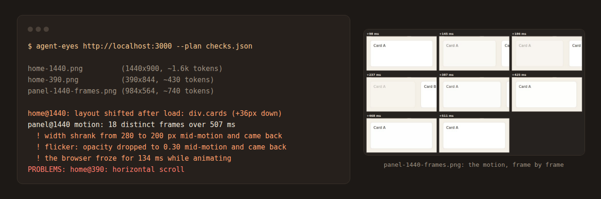
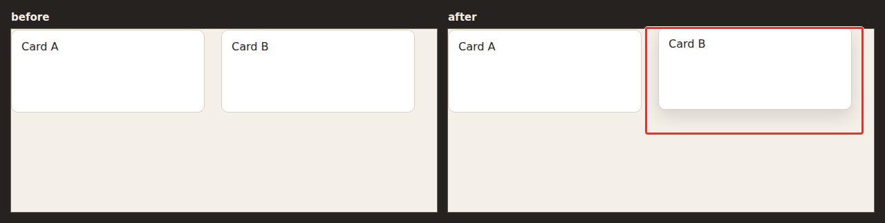

# agent-eyes

**Your coding agent can't see the screen it just changed. agent-eyes lets it, motion included.**

One shell command takes the screenshots an agent needs (logged in, at every width, after clicks and
hovers) and hands back what is wrong **as text**: an animation that squeezes, flickers, snaps or freezes,
content that jumps after load, a page that scrolls sideways on a phone. The agent reads a few lines and
opens an image only when it has to.


<sub>Output shortened. The frame strip is a real capture from the demo app.</sub>

[Português abaixo](#em-português) · [Benchmark](docs/benchmark.md) · MIT · Node 18+ · local, no cloud

## Why it's worth a try

- **It catches the bugs agents ship.** Screenshots are stills; motion bugs live between them. agent-eyes
  records the motion at real speed and *measures* it, so "the panel snaps open instead of sliding" comes
  back as a sentence, not as something a human has to notice and describe.
- **Measured on a real codebase, it found more, faster and cheaper.** Same task, same model, with and
  without it: **6 of 9** planted defects found instead of **4 of 9**, in **22% less time** and for
  **23% less money**, with zero throwaway scripts ([details](#measured-on-a-real-project)).
- **No more throwaway Playwright scripts.** In one real project, agents wrote ~210 capture scripts in
  three weeks, ~200 of them re-implementing the login. Here the login lives in a config file, once.
- **Text first, images only when needed.** Every image an agent opens stays in its context and is
  re-read on every later step. agent-eyes prints each image's token cost, says `identical` when nothing
  changed, and boxes what did.
- **Works with any agent that runs a shell.** Ships a skill for Claude Code and a block for `AGENTS.md`
  (Codex, Cursor, Gemini CLI, ...). Only dependency: Playwright.

## Quickstart (30 seconds)

```bash
npm install -g github:muhlegger/agent-eyes
agent-eyes install                       # downloads Chromium once (add --with-deps on a fresh Linux)
agent-eyes http://localhost:3000 /settings --widths 1440,390

# teach your agent to use it
mkdir -p .claude/skills/agent-eyes && agent-eyes skill > .claude/skills/agent-eyes/SKILL.md   # Claude Code
agent-eyes skill >> AGENTS.md                                                                 # other agents
```

(There is an unrelated `agent-eyes` package on npm: install from GitHub, as above.)

## What it catches

| You changed... | agent-eyes tells the agent |
|---|---|
| An animation or transition | it **shrank and came back**, **snapped** (a size that jumps in one frame: the transition is written but not running), **flickered**, **disappeared**, **left its path**, or the browser **froze** (above ~50 ms is felt) |
| A page that loads data | which elements **jumped after load**, and by how much |
| A layout | **horizontal scroll** on a phone, at every width you asked for |
| Anything | **page errors**, **server 5xx**, **actions that missed** their target |
| A screen, compared with before | `identical` (nothing to open), or one image with **each changed region boxed in red**, listed as text |


## The bug that shipped

On a real product, a side panel was meant to slide open. The width transition was written in the CSS, but
a later `transition:` rule on the same element replaced the property list, so the column snapped open in a
single frame while its content faded in. The code reads as animated; only watching it shows it isn't. It
reached the product owner, who had to describe it ("it kind of jumps, I can't explain it") and wait for
another round.

In the benchmark below, the same defect was planted again, and none of the six agent runs (three with
v0.1.1, three without) reported it. Since v0.2, agent-eyes says it in one line:

```
panel@1536 motion: 22 distinct frames over 459 ms
  ! width jumped from 0 to 252 px in a single frame while other things animated: if it should slide,
    its transition is not running (often a later "transition:" rule on the same element replaces the property list)
```

Checked on that exact defect, and on the fixed version of the same screen, which it reports clean. The
benchmark numbers below were measured before this detection existed.

## Measured on a real project

A production Next.js app (a few hundred components), on an isolated copy with its own database reset before
every run. Three defects planted in a calendar screen; the prompt named the parts that changed and the
interactions to check, never a defect. Two
interactions had to be reported clean. Claude Code with Opus 5.5 at high effort, 3 runs per side, answer key
written before the runs, blind grading checked by hand.

| | Without agent-eyes | With agent-eyes (v0.1.1) |
|---|---|---|
| Defects found | 4 of 9 | **6 of 9** |
| False alarms | 0 | 0 |
| Time (median) | 5.0 min | **3.9 min** |
| Cost (median) | $0.97 | **$0.75** |
| Throwaway scripts written | 3 | **0** |

- Content that jumped after load was found in **3 of 3** runs with agent-eyes (it is reported as text)
  and **1 of 3** without.
- Cut-off controls on a phone, visible in any screenshot, were found by every run.
- Three runs per side is a small sample: the direction is consistent, the sizes are not precise.

On a small demo app whose code the agent can read in full, every arm found every defect, and a plain
checklist in the prompt was as good as the tool. The full methodology, both benchmarks, the raw results
and how to reproduce them: [docs/benchmark.md](docs/benchmark.md).

## A whole check in one call

Steps are what an agent pays for: each one re-reads the whole conversation. So the agent plans the check
once and runs it in one call, with one browser and one login:

```bash
agent-eyes http://localhost:3000 --plan '[
  {"route": "/orders", "widths": ["1440", "390"]},
  {"name": "panel", "route": "/orders/{id}", "actions": ["click:text=Details"], "frames": true, "measure": "#details", "widths": ["1440"]},
  {"name": "hover", "route": "/orders", "actions": ["hover:.order-card"], "element": ".order-card", "widths": ["1440"]}
]' --var id=42
```

A check that fails is reported and the others still run.

## More

```bash
# A state behind a click, step by step
agent-eyes http://localhost:3000 /calendar --action "click:text=Month" --action "hover:[data-day]" --each-step

# Did my change do what I meant, and nothing else?
agent-eyes http://localhost:3000 /settings -o /tmp/before        # before editing
agent-eyes http://localhost:3000 /settings --compare /tmp/before # after

# Is the panel animation clean?
agent-eyes http://localhost:3000 /calendar --action "click:[data-day]" --frames --measure "[data-day-panel]"

# Crop to what you changed (a crop often costs under 100 tokens to read, a full screen ~1.5k)
agent-eyes http://localhost:3000 /invoices --element ".invoice-table"
```



Actions: `click`, `hover`, `scroll`, `type`, `press`, `wait`, in order. Selectors are Playwright's
(`text=Save`, CSS). `agent-eyes --help` lists everything.

## Config (optional)

`agent-eyes.config.json` in the project folder:

```json
{
  "baseUrl": "http://localhost:3000",
  "widths": ["1440", "390"],
  "viewports": { "1536": "1536x730" },
  "locale": "en-US",
  "login": {
    "path": "/login",
    "fields": { "input[type=email]": "dev@example.com", "input[type=password]": "${APP_PASSWORD}" },
    "submit": "button[type=submit]"
  }
}
```

`${NAME}` reads the environment, so passwords stay out of the file. The session is saved and reused, and
it logs in again when it expires. For OAuth or 2FA, save a session once with Playwright and pass
`--storage-state <file>`.

## How the motion check works

Chromium can stream a frame on every repaint: ~60 per second while something animates, none when nothing
changes, so the end of the motion finds itself. In parallel, a tiny sampler in the page records the measured
element's box and opacity on every animation frame, plus how many animations are running. The frames become
one image of ~10; the numbers become a few lines.

It records at real speed on purpose. Slowing animations down to catch more frames looks easier, but apps
chain steps on timers (`setTimeout(remove, 80)`): the CSS would slow down, the timers would not, and the
capture would show glitches that don't exist.

## Compared with

| | Best when |
|---|---|
| **agent-eyes** | The agent changed the UI and wants to check it: one stateless call, findings as text, motion included. |
| [Playwright CLI](https://github.com/microsoft/playwright-cli), [agent-browser](https://agent-browser.dev) | The agent must drive the app step by step (fill a flow, explore), keeping a browser session open. |
| [ProofShot](https://github.com/AmElmo/proofshot) | A human reviewer wants a proof package: session video, logs, a PR comment. |

What agent-eyes adds: motion **measured** rather than recorded for a human to watch, comparisons answered
**as text**, the **token cost** of each image, and the login handled from config. They combine well: drive
with one, check with this. (As of November 2026, from their documentation.)

## Limits

- Chromium only, web apps only.
- It finds what is broken, not what is ugly: whether a motion *feels* right stays with a human.
- Actions are real: clicking Save saves. Point it at a dev or test environment.
- Token costs use Claude's published image formula; other models differ in detail, not in order of magnitude.

## Em português

**O seu agente de código não enxerga a tela que acabou de mudar. O agent-eyes faz ele enxergar, inclusive
o movimento.**

Num comando só, o agente tira os prints de que precisa (já logado, em todas as larguras, depois de clicar e
passar o mouse) e recebe **em texto** o que está errado: a animação que encolhe, pisca, pula de uma vez ou
trava, o conteúdo que salta depois de carregar, a página que rola para o lado no celular. Ele lê poucas
linhas e só abre imagem quando precisa.

- **Pega o defeito que o agente entrega.** O movimento é gravado em velocidade real e medido: "o painel abre
  de uma vez em vez de deslizar" volta como frase, e não como algo que uma pessoa tem de notar e descrever.
- **Medido num projeto real:** com o agent-eyes, os agentes acharam **6 de 9** defeitos plantados, contra
  **4 de 9** sem ele, em **22% menos tempo** e **23% mais barato**, sem escrever nenhum script descartável
  (Opus 5.5, 3 rodadas por lado, correção às cegas conferida à mão).
- **Fim dos scripts de Playwright descartáveis:** num projeto real foram ~210 em três semanas, ~200
  refazendo o login. Aqui o login fica num arquivo de configuração, uma vez.
- **Texto primeiro:** cada imagem sai com o custo para o agente ler; "idêntico" quando nada mudou, e o que
  mudou marcado em vermelho.
- **Funciona com qualquer agente que roda comandos:** traz a skill do Claude Code e o bloco do `AGENTS.md`.

```bash
npm install -g github:muhlegger/agent-eyes
agent-eyes install
agent-eyes http://localhost:3000 /configuracoes --widths 1536,375 --locale pt-BR
mkdir -p .claude/skills/agent-eyes && agent-eyes skill > .claude/skills/agent-eyes/SKILL.md
```

## Development

```bash
npm install
npm test                          # end to end on the demo app in examples/demo
node test/make-readme-images.mjs  # regenerates docs/*.png
```

MIT license.
