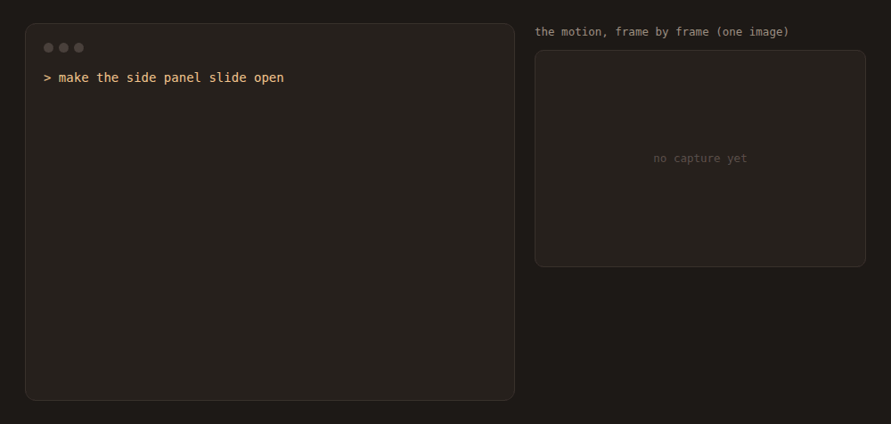
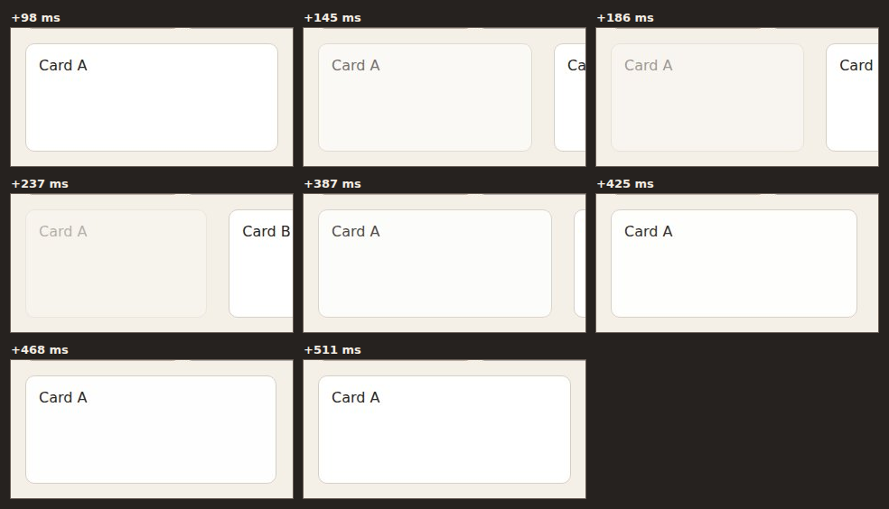

# agent-eyes

**Stop being your agent's eyes.**

Your coding agent says "done" about a screen it never saw. Then you open the page, notice the panel that
snaps instead of sliding, describe it badly, and wait for another round.

agent-eyes gives the agent that look, motion included. One shell command takes the screenshots (logged in,
at every width, after clicks and hovers) and hands back what is wrong **as text**: an animation that
squeezes, flickers, snaps or freezes, content that jumps after load, a page that scrolls sideways on a
phone. The agent reads a few lines and opens an image only when it has to.


<sub>The tool lines and both frame strips are real output from the bundled demo page, shortened. The chat lines around them are staged.</sub>

[](https://github.com/muhlegger/agent-eyes/actions/workflows/test.yml)
[](https://www.npmjs.com/package/@muhlegger/agent-eyes)

[Português abaixo](#em-português) · [Benchmark](docs/benchmark.md) · MIT · Node 18+ · local, no cloud

**Use it from:** a shell command · a [Claude Code plugin](#claude-code) · an [MCP server](#cursor-windsurf-claude-desktop-any-mcp-client) for Cursor, Windsurf and others

## Sound familiar?

Almost every change an agent makes to a web app ends up on a screen, and someone has to look at it. Today
that someone is you.

| Your day now | With agent-eyes |
|---|---|
| The agent says "done". You open the page and it isn't. | The agent looks before it says "done", and reads what is wrong. |
| You take a screenshot, paste it, describe the problem ("it kind of jumps"), wait, and repeat. | The agent takes its own screenshots, logged in. The problem comes back as a sentence with numbers: `width jumped from 0 to 252 px in a single frame`. |
| It walks past things anyone would see: content that jumps after load, a page that scrolls sideways on a phone, an error on the page. | Every run reports them as text, whether or not anyone asked. |
| Animations are invisible to it. A screenshot is a still, and a transition that never runs looks perfect before and after. | The motion is recorded at real speed and measured: shrink-and-return, snap, flicker, freeze. |
| When the agent does look, it writes a throwaway script first. In my sessions that took a median of 1.2 min per look, and one script in five was rewritten before it showed anything. | One command. The login lives in a config file, once. |
| Screenshots pile up in the conversation and are re-read on every later step. | Text first. Each image is listed with its token cost, and `identical` means there is nothing to open. |

What it does not do is make a design beautiful: taste stays with you. It takes away the rounds you spend
on what is broken, so the rounds you do spend are about the design.

- **Measured on a real codebase, it found more, faster and cheaper.** Same task, same model, with and
  without it: **6 of 9** planted defects found instead of **4 of 9**, in **22% less time** and for
  **23% less money**, with zero throwaway scripts ([details](#measured-on-a-real-project)).
- **Works with the agent you already use.** A Claude Code plugin, an MCP server (Cursor, Windsurf, Claude
  Desktop, ...) and a block for `AGENTS.md` (Codex, Gemini CLI, ...). Only dependency: Playwright. Runs
  locally, nothing leaves your machine.

## Quickstart (30 seconds)

```bash
npm install -g @muhlegger/agent-eyes
agent-eyes install                       # downloads Chromium once (add --with-deps on a fresh Linux)
agent-eyes http://localhost:3000 /settings --widths 1440,390
```

Or without installing: `npx -y @muhlegger/agent-eyes http://localhost:3000 /settings`. (The package is `@muhlegger/agent-eyes`; the
unscoped `agent-eyes` on npm is unrelated.)

Then tell your agent it exists. Pick one:

### Claude Code

```
/plugin install agent-eyes --marketplace muhlegger/agent-eyes
```

On versions before 2.1.275: `/plugin marketplace add muhlegger/agent-eyes`, then
`/plugin install agent-eyes@agent-eyes`. The plugin is one skill: Claude reaches for agent-eyes after a
visual change instead of writing a Playwright script. Prefer a plain file in one project?
`mkdir -p .claude/skills/agent-eyes && agent-eyes skill > .claude/skills/agent-eyes/SKILL.md`.

### Cursor, Windsurf, Claude Desktop, any MCP client

```json
{
  "mcpServers": {
    "agent-eyes": { "command": "agent-eyes", "args": ["mcp"] }
  }
}
```

(Without a global install: `"command": "npx", "args": ["-y", "@muhlegger/agent-eyes", "mcp"]`.)

In `.cursor/mcp.json` (Cursor), `~/.codeium/windsurf/mcp_config.json` (Windsurf) or your client's MCP
settings. Three tools: `check_ui` (the whole check in one call, findings as text), `view_image` (open one
of the images it listed, only when needed) and `compare_images`. Images are never pushed into the
conversation: the agent asks for the ones it wants, knowing what each costs.

### Codex, Gemini CLI and other agents with a shell

```bash
agent-eyes skill >> AGENTS.md
```

## What it catches

| You changed... | agent-eyes tells the agent |
|---|---|
| An animation or transition | it **shrank and came back**, **snapped** (a size that jumps in one frame: the transition is written but not running), **flickered**, **disappeared**, **left its path**, or the browser **froze** (above ~50 ms is felt) |
| A page that loads data | which elements **jumped after load**, and by how much |
| A layout | **horizontal scroll** on a phone, at every width you asked for |
| Anything | **page errors**, **console errors**, **requests that failed** (404, 5xx), **actions that missed** their target |
| A theme | the same screen in **dark** or **light**, or with **reduced motion** (`--color-scheme dark`, `--reduced-motion`) |
| A screen, compared with before | `identical` (nothing to open), or one image with **each changed region boxed in red**, listed as text |



## Where it fits in your day

It is one command, so it goes wherever a command goes.

| When | How | What comes back |
|---|---|---|
| **The agent changed a screen** | The plugin, the MCP server or the `AGENTS.md` block: the agent runs it before saying "done" | What is wrong, as text. This is what it was built for. |
| **A refactor that should change nothing** | `-o /tmp/before`, refactor, then `--compare /tmp/before` | `identical`, or each changed region boxed in red |
| **"Does it work on a phone?"** | `--widths 1440,768,390` | Sideways scroll and cut-off content, per width |
| **A gate** in a pre-commit hook or in CI | `--strict` | Exit code 1 when anything is found |
| **A trigger** in Claude Code | A `Stop` hook around `--strict` | The turn cannot end while the screen is broken |

The trigger is [a few lines of shell](examples/hooks/look-before-done.sh). When the agent touched UI files and
tries to finish, the hook looks at the screens you listed. If something is wrong, Claude Code sends the
findings back as the agent's next input:

```
Stop hook feedback:
glitch@1280 motion: 21 distinct frames over 508 ms
  ! the browser froze for 126 ms while animating (noticeable above ~50 ms)
  ! width shrank from 280 to 200 px mid-motion and came back (see the frames)
```

That is real output, shortened, from the bundled demo page with its planted glitch. With the screen clean, the turn
ends as usual.

## Why an agent needs a look it can run

Anthropic's guide to Claude Code puts the problem this way
([Give Claude a check to run](https://code.claude.com/docs/en/best-practices#give-claude-a-check-to-run)):

> Claude stops when the work looks done. If it has nothing to run that tells it whether the work actually
> *is* done, "looks done" is all it has to go on. In practice that makes you the test suite, and every
> mistake sits there until you happen to notice it.

The guide lists a browser screenshot among the checks, next to tests and linters. Anthropic's engineers ran
into the same thing building apps with long-running agents: "agents reliably skew positive when grading
their own work", and apps "often looked impressive but still had real bugs when you actually tried to use
them", so they gave the reviewing agent a browser to use the live page before scoring
([Harness design for long-running application development](https://www.anthropic.com/engineering/harness-design-long-running-apps), March 2026).

For code, the check is a test. For a screen, the check is looking, and looking is the expensive one:

- **The agent writes a script for every look.** The scripts work; the cost is in the repetition. In three
  weeks of my own sessions on one project: ~210 throwaway Playwright scripts, ~200 of them re-implementing
  the login. Across 166 of them, it took a median of 1.2 min (mean 3.3) from starting the script to seeing
  the image; 44 ran more than once and 33 were rewritten (the login, a selector, a server still compiling).
- **A screenshot is a still.** A transition that never runs looks perfect in the before and in the after.
- **Images are heavy.** Each one stays in the conversation and is re-read on every later step.

agent-eyes is that look made cheap: one command, the answer as text, pass or fail with `--strict`.

Neither source puts a number on how much a check helps. The only numbers on this page are mine, from a
small sample, [below](#measured-on-a-real-project). agent-eyes is not affiliated with Anthropic.

## The bug that shipped

On a real product, a side panel was meant to slide open. The width transition was written in the CSS, but
a later `transition:` rule on the same element replaced the property list, so the column snapped open in a
single frame while its content faded in. The code reads as animated; only watching it shows it isn't. It
reached the product owner, who had to describe it ("it kind of jumps, I can't explain it") and wait for
another round.

In the benchmark below, the same defect was planted again, and none of the six agent runs (three with
v0.1.1, three without) reported it. Since v0.2, agent-eyes says it in one line:

```
panel@1536 motion: 22 distinct frames over 459 ms
  ! width jumped from 0 to 252 px in a single frame while other things animated: if it should slide,
    its transition is not running (often a later "transition:" rule on the same element replaces the property list)
```

Checked on that exact defect, and on the fixed version of the same screen, which it reports clean. The
benchmark numbers below were measured before this detection existed.

## Measured on a real project

A production Next.js app (a few hundred components), on an isolated copy with its own database reset before
every run. Three defects planted in a calendar screen; the prompt named the parts that changed and the
interactions to check, never a defect. Two
interactions had to be reported clean. Claude Code with Opus 5.5 at high effort, 3 runs per side, answer key
written before the runs, blind grading checked by hand.

| | Without agent-eyes | With agent-eyes (v0.1.1) |
|---|---|---|
| Defects found | 4 of 9 | **6 of 9** |
| False alarms | 0 | 0 |
| Time (median) | 5.0 min | **3.9 min** |
| Cost (median) | $0.97 | **$0.75** |
| Throwaway scripts written | 3 | **0** |

- Content that jumped after load was found in **3 of 3** runs with agent-eyes (it is reported as text)
  and **1 of 3** without.
- Cut-off controls on a phone, visible in any screenshot, were found by every run.
- Three runs per side is a small sample: the direction is consistent, the sizes are not precise.

On a small demo app whose code the agent can read in full, every arm found every defect, and a plain
checklist in the prompt was as good as the tool. The full methodology, both benchmarks, the raw results
and how to reproduce them: [docs/benchmark.md](docs/benchmark.md).

## A whole check in one call

Steps are what an agent pays for: each one re-reads the whole conversation. So the agent plans the check
once and runs it in one call, with one browser and one login:

```bash
agent-eyes http://localhost:3000 --plan '[
  {"route": "/orders", "widths": ["1440", "390"]},
  {"name": "panel", "route": "/orders/{id}", "actions": ["click:text=Details"], "frames": true, "measure": "#details", "widths": ["1440"]},
  {"name": "hover", "route": "/orders", "actions": ["hover:.order-card"], "element": ".order-card", "widths": ["1440"]}
]' --var id=42
```

A check that fails is reported and the others still run.

## More

```bash
# A state behind a click, step by step
agent-eyes http://localhost:3000 /calendar --action "click:text=Month" --action "hover:[data-day]" --each-step

# Did my change do what I meant, and nothing else?
agent-eyes http://localhost:3000 /settings -o /tmp/before        # before editing
agent-eyes http://localhost:3000 /settings --compare /tmp/before # after

# Is the panel animation clean?
agent-eyes http://localhost:3000 /calendar --action "click:[data-day]" --frames --measure "[data-day-panel]"

# Crop to what you changed (a crop often costs under 100 tokens to read, a full screen ~1.5k)
agent-eyes http://localhost:3000 /invoices --element ".invoice-table"
```


Actions: `click`, `hover`, `scroll`, `type`, `press`, `wait`, in order. Selectors are Playwright's
(`text=Save`, CSS). `agent-eyes --help` lists everything.

## Config (optional)

`agent-eyes.config.json` in the project folder:

```json
{
  "baseUrl": "http://localhost:3000",
  "widths": ["1440", "390"],
  "viewports": { "1536": "1536x730" },
  "locale": "en-US",
  "login": {
    "path": "/login",
    "fields": { "input[type=email]": "dev@example.com", "input[type=password]": "${APP_PASSWORD}" },
    "submit": "button[type=submit]"
  }
}
```

`${NAME}` reads the environment, so passwords stay out of the file. The session is saved and reused, and
it logs in again when it expires. For OAuth or 2FA, save a session once with Playwright and pass
`--storage-state <file>`.

## How the motion check works

Chromium can stream a frame on every repaint: ~60 per second while something animates, none when nothing
changes, so the end of the motion finds itself. In parallel, a tiny sampler in the page records the measured
element's box and opacity on every animation frame, plus how many animations are running. The frames become
one image of ~10; the numbers become a few lines.

It records at real speed on purpose. Slowing animations down to catch more frames looks easier, but apps
chain steps on timers (`setTimeout(remove, 80)`): the CSS would slow down, the timers would not, and the
capture would show glitches that don't exist.

## Compared with

| | Best when |
|---|---|
| **agent-eyes** | The agent changed the UI and wants to check it: one stateless call, findings as text, motion included. |
| [Playwright CLI](https://github.com/microsoft/playwright-cli), [agent-browser](https://agent-browser.dev) | The agent must drive the app step by step (fill a flow, explore), keeping a browser session open. |
| [ProofShot](https://github.com/AmElmo/proofshot) | A human reviewer wants a proof package: session video, logs, a PR comment. |

What agent-eyes adds: motion **measured** rather than recorded for a human to watch, comparisons answered
**as text**, the **token cost** of each image, and the login handled from config. They combine well: drive
with one, check with this. (As of November 2026, from their documentation.)

## Limits

- Chromium only, web apps only.
- It finds what is broken, not what is ugly: whether a motion *feels* right stays with a human.
- Actions are real: clicking Save saves. Point it at a dev or test environment.
- Token costs use Claude's published image formula; other models differ in detail, not in order of magnitude.

## Em português

**Pare de ser os olhos do seu agente.**

O agente diz "pronto" sobre uma tela que nunca viu. Aí você abre a página, nota o painel que pula em vez de
deslizar, descreve mal e espera outra rodada. O agent-eyes dá esse olhar ao agente, inclusive o movimento.

Num comando só, o agente tira os prints de que precisa (já logado, em todas as larguras, depois de clicar e
passar o mouse) e recebe **em texto** o que está errado: a animação que encolhe, pisca, pula de uma vez ou
trava, o conteúdo que salta depois de carregar, a página que rola para o lado no celular. Ele lê poucas
linhas e só abre imagem quando precisa.

- **Pega o defeito que o agente entrega.** O movimento é gravado em velocidade real e medido: "o painel abre
  de uma vez em vez de deslizar" volta como frase, e não como algo que uma pessoa tem de notar e descrever.
- **Medido num projeto real:** com o agent-eyes, os agentes acharam **6 de 9** defeitos plantados, contra
  **4 de 9** sem ele, em **22% menos tempo** e **23% mais barato**, sem escrever nenhum script descartável
  (Opus 5.5, 3 rodadas por lado, correção às cegas conferida à mão).
- **Fim dos scripts de Playwright descartáveis:** num projeto real foram ~210 em três semanas, ~200
  refazendo o login. Aqui o login fica num arquivo de configuração, uma vez.
- **Texto primeiro:** cada imagem sai com o custo para o agente ler; "idêntico" quando nada mudou, e o que
  mudou marcado em vermelho.
- **Serve de trava e de gatilho:** com `--strict` o comando falha quando acha algo (pre-commit, CI), e um
  [hook de poucas linhas](examples/hooks/look-before-done.sh) impede o Claude Code de encerrar a vez com a tela
  quebrada.
- **Funciona com o agente que você já usa:** plugin do Claude Code, servidor MCP (Cursor, Windsurf, Claude
  Desktop e outros) e o bloco do `AGENTS.md`. Roda na sua máquina; nada sai dela.

```bash
npm install -g @muhlegger/agent-eyes
agent-eyes install
agent-eyes http://localhost:3000 /configuracoes --widths 1536,375 --locale pt-BR
```

Depois, conte ao seu agente que ela existe: no Claude Code, `/plugin install agent-eyes --marketplace
muhlegger/agent-eyes`; no Cursor e em outros clientes MCP, o servidor `agent-eyes mcp` (configuração
[acima](#cursor-windsurf-claude-desktop-any-mcp-client)); nos demais, `agent-eyes skill >> AGENTS.md`.

## Development

```bash
npm install
npm test                          # end to end on the demo app in examples/demo (command line and MCP server)
node test/make-readme-images.mjs  # regenerates docs/*.png
npm install --no-save gifenc pngjs && node test/make-demo-gif.mjs   # regenerates docs/demo.gif
```

Ideas and bug reports are welcome: see [CONTRIBUTING.md](CONTRIBUTING.md).

MIT license.
